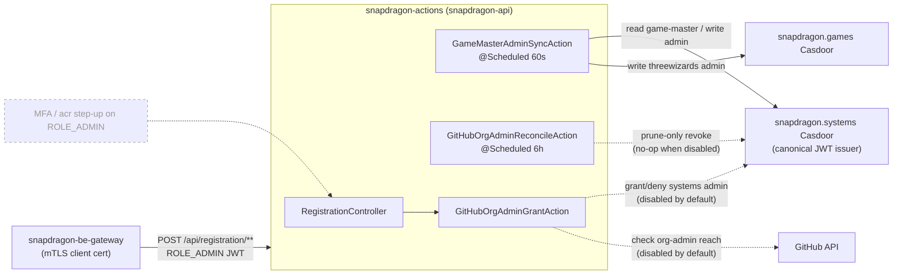

# snapdragon-actions

Reactive Spring (WebFlux, Java 21, `@EnableScheduling`) service that runs
the Snapdragon platform's **cross-stack role-reconciliation** jobs and
hosts the **registration org-admin grant** endpoint. Stateless by
design — every scheduled tick reads source-of-truth from the canonical
Casdoor instances (and GitHub) and reconciles the downstream
side-effect; the only durable state lives in Casdoor, never here (the
GitHub-token cache is a process-local, best-effort optimisation —
losing it on a restart only delays an auto-revoke).

## Where it sits in the platform

| | |
|---|---|
| **Tier** | Backend effector / reconciler — talks to Casdoor admin APIs + GitHub; not a user-facing UI. |
| **In-cluster identity** | Deployed under the name **`snapdragon-api`** (its mTLS identity is the `snapdragon-api-mtls` ESO Secret). The deployment manifest lives in `snapdragon-generator` (`specs/cluster/manifests/snapdragon-apis/`), not in this repo. See [SECURITY.md](SECURITY.md). |
| **Port** | `8090` local/dev (env `PORT`); the in-cluster deployment maps it to `8080`. |
| **Fronted by** | `snapdragon-be-gateway` — the legitimate caller of `/api/registration/**`; an external client never reaches this API directly. |
| **Trusts** | The **snapdragon.systems Casdoor** as its canonical JWT issuer (this surface mutates state in *both* the systems and games Casdoors, so only the systems side is trusted to authorize the call). |

The reconcilers in this service are what make two platform invariants
self-healing rather than sign-in-only: a `game-master` on
snapdragon.systems automatically becomes an `admin` on snapdragon.games,
and a platform admin who loses their GitHub org-admin reach
automatically loses snapdragon.systems admin.



Solid edges are **✅ shipped** and active by default; the dotted
GitHub-org-admin edges are shipped but **gated off by default**
(`app.actions.gh-org-admin.enabled=false`); the greyed `MFA` node is
**🔭 planned** (no code yet — see [Roadmap](#roadmap--planned-not-shipped)).

## Actions

### `GameMasterAdminSyncAction` — systems game-master → games admin

Propagates the `game-master` role from snapdragon.systems Casdoor into
the `admin` role on snapdragon.games Casdoor. Scheduled every
`app.actions.game-master-sync.interval-ms` (default **60 s**).

Each tick reads both role memberships, computes the desired games-admin
set by rewriting every systems member's `<org>/<username>` identifier to
the games organization (`snapdragon-systems/alice` →
`threewizards/alice`), and POSTs the new membership to games Casdoor
**only when it actually differs**. Idempotent (a no-change tick writes
nothing) and stateless. The per-Casdoor side-effect is wrapped in a
Resilience4j `@CircuitBreaker(name="casdoor")` so a stalled Casdoor
opens the breaker and the next tick retries instead of piling up work.

| systems `game-master` | games `admin` (before) | games `admin` (after) |
|---|---|---|
| `{alice, bob}` | `{alice}` | `{alice, bob}` |
| `{alice}` | `{alice, dropped}` | `{alice}` |
| `{alice}` | `{alice}` | `{alice}` (no-op) |

### `GitHubOrgAdminGrantAction` — GitHub org admin → systems admin

> **Disabled by default (✅ shipped).** The whole GitHub-org-admin
> auto-grant feature is gated behind a master switch
> `app.actions.gh-org-admin.enabled` (env `GH_ORG_ADMIN_ENABLED`),
> **default `false`**. While disabled the evaluate endpoint returns
> **`404`** (not `403`), the scheduled reconciler is a **no-op** (no
> GitHub calls, no Casdoor writes), and the cached-token path is never
> seeded. Superadmin opts in by setting the env var and rolling the pod;
> everything below describes the **enabled** behaviour.

Auto-grants snapdragon.systems `admin` to a GitHub-authenticated user
who holds admin authority on a configured Snapdragon GitHub org —
either **org-level admin** (`GET /user/memberships/orgs/{org}` → `admin`)
**or** admin permission on **any repo** owned by that org (a paginated
walk of `GET /user/repos`). Orgs default to
`Snapdragon-Systems,Snapdragon` (`app.actions.gh-org-admin.orgs`); the
granted role defaults to `admin` (`…systems-admin-role`).

It has two entry points, plus a scheduled revoke loop:

| Caller | Trigger | Behaviour |
|---|---|---|
| **Sign-up (on demand)** | `POST /api/registration/github-org-admin/evaluate` | Evaluates the forwarded GitHub token; on a match adds the user to systems-admin and returns the Casdoor member id, otherwise `403`. Caches the forwarded GitHub token so the reconciler can re-check the user later. |
| **Reconcile (scheduled)** | `GitHubOrgAdminReconcileAction` | Revokes systems-admin from users whose GitHub admin reach has dropped to zero. |

GitHub admin reach is only visible through **the user's own token**
(there is no service-account view of another user's private org/repo
admin), so the evaluate call seeds that token into an in-memory
`GitHubTokenCache` (TTL `app.actions.gh-org-admin.token-ttl`, default
**24 h**) for the reconciler to replay. The GitHub-side calls are
guarded by a `@CircuitBreaker(name="github")` so a GitHub outage fails
fast instead of cascading through every sign-up evaluation.

### `GitHubOrgAdminReconcileAction` — scheduled prune-only revoke loop

Closes the audit gap where an admin who loses GitHub org-admin reach
would otherwise keep systems-admin until their next sign-in. Mirrors the
sync action's shape (reactive `Mono`/`Flux` pipeline,
`@CircuitBreaker(name="github")`, configurable `…reconcile.interval-ms` /
`…initial-delay-ms`, default **6 h**).

Each tick:

1. Reads the current member list of the systems-admin role from
   snapdragon.systems Casdoor.
2. **Phase 1 — concurrent read-only scan** (bounded to 4 in flight):
   for every member we hold a **fresh** GitHub token for, replays it
   against GitHub and collects the usernames whose reach has dropped to
   zero. Members with no fresh token are **skipped** (never revoked on
   missing/stale evidence); a transient/inconclusive GitHub error is
   also treated as missing evidence and skipped.
3. **Phase 2 — single serialized write**: removes the whole loser set in
   one `getRoleMembers → removeAll → setRoleMembers`, which closes the
   lost-update race that a per-user read-modify-write would have. An
   empty loser set writes nothing.

The loop is **prune-only** (it only ever removes admin, never grants)
and **idempotent** (a tick where everyone still has reach is a pure read
with zero writes). The token cache is process-local and best-effort:
losing it (a pod restart) only delays an auto-revoke until the user
signs in again; the grants themselves live in Casdoor.

## HTTP surface

The only request endpoint is the registration org-admin gate; the rest
of the service is scheduled work with no request principal.

`POST /api/registration/github-org-admin/evaluate` — body
`{ githubAccessToken, snapdragonUsername }` (both bounded + charset-
validated by Jakarta Bean Validation → `400` on malformed input). Called
by the **snapdragon.games registration remote's BFF** after a new user
completes external GitHub OAuth; it forwards the user's GitHub
access-token + their freshly-minted Casdoor username. The controller, in
order:

1. **Local reserved-username gate** (runs unconditionally) — rejects
   `422` any username that, normalised to the vanity-subdomain DNS-label
   form, collides with a dedicated gateway route/prefix. The reserved
   list (`ReservedNames`, currently **62 labels**) is the canonical union
   of the fe-/be-gateway route prefixes, reserved subdomains, the
   snapdragon.games app routes, and defensive infra names — **kept
   byte-for-byte in lockstep** with `snapdragon-gateway`'s `CanonicalSeed`
   and `snapdragon-admin-bff-api`'s copy (all three must agree on the same
   62). This is defence-in-depth; Casdoor's own forbidden-username policy
   is the source gate.
2. **Federation confusable / availability gate** (defence-in-depth,
   **config-gated, default off**) — when
   `app.federation.username-check.enabled=true`, asks
   `snapdragon-federation-api`
   (`GET /api/federation/username/{candidate}/availability`, a
   ROLE_SERVICE call) to catch homoglyph / look-alike / reserved-
   confusable handles the exact local check can't see, and rejects `422`
   on a collision. The check **fails closed** — a federation outage
   rejects rather than mints a look-alike. The service bearer is minted
   via the OAuth2 client-credentials grant against systems Casdoor
   (reusing `app.casdoor.systems.*`) and cached/re-minted.
3. **Grant** — only when both gates pass, runs
   `GitHubOrgAdminGrantAction.evaluateAndGrant`; returns
   `{ memberId }` on success or `403` when the user has no Snapdragon
   org-admin reach. **When the master switch
   `app.actions.gh-org-admin.enabled` is `false` (the default), this step
   short-circuits and the endpoint returns `404`** — the reserved-name
   and confusable gates above still run, but no grant is ever attempted.

## Security & multi-tenancy

The service is defended in depth by two independent layers (full detail
in [SECURITY.md](SECURITY.md)):

- **OAuth2 resource server (application layer).** Validates Casdoor-
  issued JWTs from the systems Casdoor issuer. Path policy (reactive
  `SecurityConfig`):
  - `/actuator/health` + `/actuator/info` — public (probes);
  - `/actuator/**` — `ROLE_GAME-MASTER` (metrics / Prometheus / Casdoor
    reachability never leak);
  - `/api/registration/**` — `ROLE_ADMIN`;
  - SpringDoc spec + Swagger-UI (`/v3/api-docs/**`, `/swagger-ui/**`,
    `/swagger-ui.html`, `/webjars/swagger-ui/**`) — **permitAll under
    `dev`/`test`** (so the platform's `ng-openapi-gen gen:fetch` can curl
    the spec locally without a token) and **`ROLE_ADMIN` in prod**;
  - everything else — authenticated.
- **Mutual TLS (transport layer).** `server.ssl.*` is parameterized and
  **off by default** (local/dev/CI run plaintext). In-cluster the
  deployment mounts the PKCS12 keystore/truststore from the
  `snapdragon-api-mtls` ESO Secret and sets `SSL_ENABLED=true` +
  `SSL_CLIENT_AUTH=need`, so the TLS handshake requires a client cert
  chaining to the cluster CA — only services signed by the Vault/ESO PKI
  process (the be-gateway) can call this API at all.

### Domain-scoping (issuer-keyed) — ✅ shipped

The platform's per-brand multi-tenancy keys a token's brand off its
**cryptographically-validated issuer** (one Casdoor per brand → distinct
`iss`). This service adopts the same canonical machinery the gateways
use, so it participates consistently. The pieces below are **part of the
service today** (merged via PR #12), and `SecurityConfig` already
delegates JWT → authority mapping to
`CasdoorAuthorities.converter(domainRegistry)` and swaps to the per-issuer
resolver only when the registry is genuinely multi-issuer:

- **`CasdoorAuthorities`** — the single canonical JWT → authority
  converter (copied from `snapdragon-gateway`), used by both the single-
  issuer and the optional multi-issuer decoder paths so they emit
  byte-identical authorities. It floors every principal to `ROLE_USER`,
  maps `roles` → `ROLE_<UPPER>`, passes `permissions` through **verbatim
  except** entries carrying a reserved prefix (`ROLE_` / `DOMAIN_`),
  which are **stripped** (authority-injection defence — a token can't
  forge a super-role or a tenant scope via a permission claim), honours
  legacy `isAdmin` → `ROLE_ADMIN`, and stamps **exactly one** issuer-
  derived `DOMAIN_<x>` authority.
- **`DomainRegistry`** — issuer-URI → brand map. **Backward-compatible:**
  with only the existing single `issuer-uri` it maps the lone issuer to
  `DOMAIN_default`, so this single-issuer cluster is byte-for-byte
  unchanged. When `app.tenancy.issuers` carries `issuer=domain` pairs it
  becomes the trusted allowlist and **fails closed** on an unknown `iss`.
- **`TenancyResourceServerConfig`** — config-gated, opt-in per-issuer
  resolver that 401s an unknown `iss` before any authority is emitted.
- **`Roles`** helpers — including the least-privilege cascade markers:
  `SUPERADMIN` (the only role exempt from per-domain scoping — the infra
  control plane) and the separate `IMAGE-BUILDER` capability.

**No per-query domain predicate is added here, by design.** This service
is a single-writer effector: its one request endpoint
(`/api/registration/github-org-admin/evaluate`, `ROLE_ADMIN`) mutates
fixed Casdoor instances + GitHub orgs regardless of the caller's brand,
and the reconcilers are scheduled (no request principal). It owns no
per-domain row store, so it gains the canonical converter + issuer-keyed
`DOMAIN_<x>` authority + multi-issuer back-compat — but there is no
domain-scoped query to filter, and none is invented.

### Roadmap — 🔭 planned (NOT shipped)

These platform-wide initiatives would touch this service when adopted.
They are **design-only today**; nothing below is in the code on `main`,
and none should be read as a current capability.

- **Casdoor MFA / step-up (🔭 planned).** A platform-wide design (9-PR
  plan) introduces WebAuthn + TOTP + recovery with `amr`/`acr` →
  `MFA_SATISFIED` and step-up enforcement on sensitive operations. Because
  this service is a Casdoor-JWT resource server and its
  `CasdoorAuthorities` / `Roles` converter is the *shared* authority
  machinery, MFA enforcement (e.g. an `mfa_satisfied` / `acr` check
  guarding the `ROLE_ADMIN` registration endpoint) would land here. No
  such check exists yet — the endpoint authorizes on `ROLE_ADMIN` alone.

## Metrics

Prometheus is exposed at `/actuator/prometheus` (gated to
`ROLE_GAME-MASTER`).

| Name | Type | Meaning |
|---|---|---|
| `actions.gm_sync.added` | counter | Members added to games-admin during a sync |
| `actions.gm_sync.removed` | counter | Members removed from games-admin during a sync |
| `actions.gm_sync.unchanged` | counter | Sync ticks where membership already matched (no write) |
| `actions.gm_sync.errors` | counter | Sync ticks that failed to read or write Casdoor |
| `actions.gh_org_admin.granted` | counter | Users granted systems-admin via GitHub org membership |
| `actions.gh_org_admin.revoked` | counter | Users stripped of systems-admin after losing GitHub reach |
| `actions.gh_org_admin.denied` | counter | Sign-up evaluate requests rejected (no Snapdragon org admin) |
| `actions.gh_org_admin.errors` | counter | Sign-up evaluations that errored before a decision |
| `actions.gh_org_admin.reconciled` | counter | Admins re-evaluated against GitHub on a reconcile tick |
| `actions.gh_org_admin.reconcile_skipped` | counter | Admins left untouched for lack of a fresh GitHub token |
| `actions.gh_org_admin.reconcile_errors` | counter | Reconcile ticks / per-user checks that failed |

## Configuration

Every Casdoor endpoint + credential, the GitHub orgs/role, the schedule
intervals, the token TTL, the federation toggle, and the mTLS stores are
env-var driven — see `src/main/resources/application.yml` for the full
list of keys and defaults. Highlights:

| Concern | Key (env override) | Default |
|---|---|---|
| Systems Casdoor | `app.casdoor.systems.*` (`CASDOOR_SYSTEMS_URL`, `…CLIENT_ID`, `…CLIENT_SECRET`, `…ORG`) | `…snapdragon-systems` |
| Games Casdoor | `app.casdoor.games.*` (`CASDOOR_GAMES_URL`, …, `CASDOOR_GAMES_ORG`) | `…threewizards` |
| JWT issuer | `spring.security.oauth2.resourceserver.jwt.issuer-uri` (`CASDOOR_SYSTEMS_URL`) | systems Casdoor |
| GM sync interval | `app.actions.game-master-sync.interval-ms` (`GM_SYNC_INTERVAL_MS`) | `60000` |
| GitHub-org-admin auto-grant | `app.actions.gh-org-admin.enabled` (`GH_ORG_ADMIN_ENABLED`) | `false` (off → evaluate returns `404`, reconciler no-op) |
| GitHub orgs | `app.actions.gh-org-admin.orgs` (`GH_ORG_ADMIN_ORGS`) | `Snapdragon-Systems,Snapdragon` |
| Granted systems role | `app.actions.gh-org-admin.systems-admin-role` (`GH_ORG_ADMIN_ROLE`) | `admin` |
| GitHub token TTL | `app.actions.gh-org-admin.token-ttl` (`GH_ORG_ADMIN_TOKEN_TTL`) | `PT24H` |
| Revoke reconcile interval | `app.actions.gh-org-admin.reconcile.interval-ms` | `21600000` (6 h) |
| Federation confusable gate | `app.federation.username-check.enabled` (`APP_FEDERATION_USERNAME_CHECK_ENABLED`) | `false` |
| GitHub API base | `app.github.base-url` (`GITHUB_API_BASE_URL`) | `https://api.github.com` |
| mTLS | `server.ssl.*` (`SSL_ENABLED`, `SSL_CLIENT_AUTH`, …) | off / `none` |

Resilience4j circuit breakers are configured per downstream
(`casdoor`, `github`, `federation`) under `resilience4j.circuitbreaker.*`.

## API docs

SpringDoc publishes the OpenAPI 3 spec at `/v3/api-docs` and Swagger-UI
at `/swagger-ui.html`, scoped to this service's own `web` package. This
is the source the platform's `ng-openapi-gen` typed-clients, the admin
api-docs/SwaggerUI federated module, and the docs pipeline consume. The
spec paths are public under `dev`/`test` and `ROLE_ADMIN` in prod (see
above).

## Running locally

```bash
docker compose up -d                       # two Casdoors (systems + games) + the action
docker compose logs -f snapdragon-actions  # watch ticks
curl localhost:8090/actuator/health        # public probe
```

The compose stack brings up two Casdoor instances (each with its own
Postgres) so the game-master → admin sync can be exercised end-to-end
without production endpoints. The action service itself is stateless —
restarting it replays the next tick against live Casdoor state.

## Build & CI

A standard Spring Boot Maven build (`./mvnw package`); the multi-stage
`Dockerfile` produces a slim JRE runtime image. CI is **GitLab**
(`.gitlab-ci.yml`): the GitHub repo is pull-mirrored into the in-cluster
GitLab, which runs the pipeline on push / mirror-sync. Images carry no
keys — PKI material is supplied from the USB at first boot.

The pipeline has three stages (`stages: [test, build, pentest]`):

1. **`test`** (✅ shipped) — runs `./mvnw verify -B` inside an
   `eclipse-temurin:21-jdk-noble` container on the default branch / merge
   requests / tags, publishing the JUnit surefire reports as artifacts.
2. **`build:image`** (✅ shipped) — `needs: [test]`; builds and pushes the
   container image to the in-cluster registry on the default branch / on
   tag, tagged with the release tag or short SHA plus a moving branch tag.
3. **`pentest`** (✅ shipped) — the continuous-OWASP stage. Thin
   `pentest:sca` / `pentest:dast` jobs `extends:` the centralized hidden
   `.pentest-sca` / `.pentest-dast-baseline` templates `include`d from
   `snapdragon-generator` (`/tests/pentest/ci/pentest-stage.gitlab-ci.yml`),
   so SCA (OWASP Dependency-Check) and DAST (authenticated ZAP baseline +
   probes + nuclei) share one source of truth across every onboarded repo.
   Both run on the default branch / merge requests with
   `allow_failure: true` so findings surface in the MR security widget
   without blocking the pipeline. `make pentest` runs the same posture
   locally as a pre-push gate (see the `Makefile`).

## Adding new actions

Each action is a `@Service` with a `@Scheduled` method;
`GameMasterAdminSyncAction` is the reference shape. Wrap any external
side-effect in a Resilience4j `@CircuitBreaker(name=…)` so a slow
downstream doesn't pile up tick work, and emit per-action Micrometer
counters for what was applied / skipped / errored.

## Native image (GraalVM)

The build carries a `native` profile (same shape as `snapdragon-gateway`)
plus app-specific AOT reflection hints in `NativeHintsConfig` for the
JSON-bound DTOs that cross the HTTP boundary and the
`@CircuitBreaker`-advised action beans:

```bash
./mvnw -Pnative native:compile   # requires a GraalVM native-image toolchain
```

The AOT pipeline (`./mvnw -Pnative spring-boot:process-aot`) is verified;
run `native:compile` on a GraalVM JDK to produce the binary.
